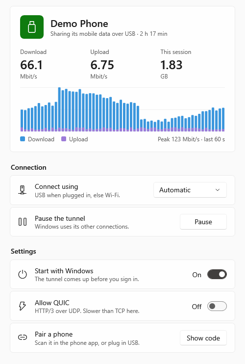
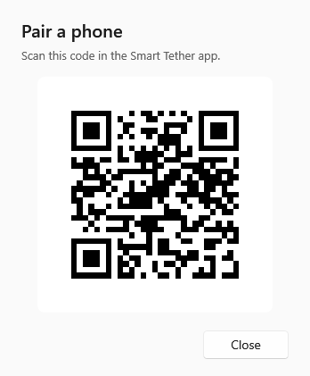
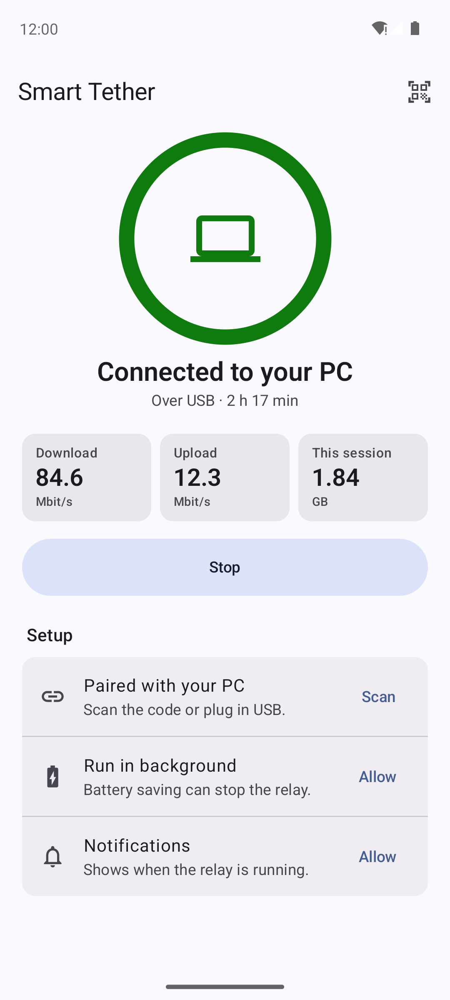
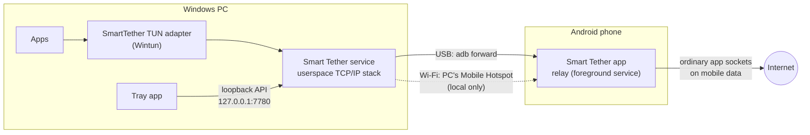

# Smart Tether

Use your Android phone's mobile data on your Windows PC over USB or Wi-Fi, without turning on
the phone's hotspot or USB tethering, and switch between USB and Wi-Fi without dropping open
connections.

## Screenshots

| Windows app | Pairing code | Phone app |
| --- | --- | --- |
|  |  |  |

The screenshots show demo data (a made-up phone name, traffic and pairing code).

## Features

- **USB or Wi-Fi, switched automatically.** Plug the cable in and the link moves to USB; unplug
  it and it carries on over Wi-Fi. Open connections are kept across the switch and across short
  drop-outs (up to about 30 seconds).
- **TCP, UDP and DNS.** UDP keeps a stable public port per PC socket, also across USB/Wi-Fi
  switches, so voice calls and games keep working. QUIC (HTTP/3 over UDP/443) is off by default
  and can be turned on in the PC app.
- **Runs in the background.** The PC side is a Windows service (optionally started with
  Windows); the phone side is a foreground service that keeps running with the screen off.
- **Falls back cleanly.** When the phone has been unreachable for 10 seconds, or you press
  *Pause*, Windows goes back to its other connections (Ethernet, home Wi-Fi).
- **Pairing by QR code or USB**, once.
- **Tray app** with live download/upload rates, a traffic chart of the last minute, data used
  this session, and *Automatic / USB only / Wi-Fi only*.

## How it works



1. The Windows service creates a virtual network adapter and routes the PC's internet traffic
   into it. A userspace TCP/IP stack turns that traffic back into individual TCP connections,
   UDP datagrams and DNS queries.
2. These travel to the phone over one token-authenticated link (see
   [Privacy and security](#privacy-and-security)) that can move between USB and Wi-Fi without
   losing its state. The link protocol is described in [docs/DESIGN.md](docs/DESIGN.md).
3. The phone app opens a normal socket on its mobile-data network for each connection and
   relays the data. DNS queries go to the mobile network's DNS servers.

### USB and Wi-Fi

- **USB** uses adb (Android's debugging bridge): the PC forwards a local port to the phone
  through the cable. USB debugging must be on. USB is preferred whenever it is available.
- **Wi-Fi** uses the PC's own **Windows Mobile Hotspot** (network name `SmartTether`). The phone
  joins it as a local-only network: Android does not use it for the phone's own internet, and
  it never carries the phone's mobile data anywhere except to this PC. The PC turns the hotspot
  on by itself.

You can force one transport with *USB only* or *Wi-Fi only* in the tray menu or the app window.

## Requirements

- **PC:** Windows 10 version 1809 or later, or Windows 11, on x64. For the Wi-Fi link, a Wi-Fi
  adapter that supports *Mobile hotspot* (Settings > Network & internet > Mobile hotspot). USB
  works without it.
- **Phone:** Android 12 (API 31) or later, 64-bit ARM (arm64-v8a), with mobile data.
- For USB: *Developer options > USB debugging* turned on.

## Install

1. **PC:** download `SmartTether-Setup.exe` from the [latest release](../../releases/latest) and
   run it. The installer is not code-signed, so Windows SmartScreen may warn that the app is
   unrecognized: choose *More info > Run anyway*. Setup installs the Smart Tether service and the
   tray app and opens the app when it finishes.
2. **Phone:** download `SmartTether.apk` from the same release to the phone and open it to
   install (allow installing from that source when Android asks).
3. Open **Smart Tether** on the phone and go through its *Setup* list:
   - **Notifications:** allow, so Android shows that the relay is running.
   - **Run in background:** tap *Allow* (turns off battery optimization for the app).
   - On Xiaomi, Redmi and POCO phones (HyperOS / MIUI) two more rows appear:
     - **Autostart:** tap *Open* and turn Smart Tether on.
     - **Battery saver:** tap *Open* and choose *No restrictions*. These systems may stop
       background apps while the screen is off; the row shows the last time Android stopped
       the app, if it did.

## Usage

### Pair the phone with the PC (once)

Either way works:

- **QR code:** in the PC app, under *Pair a phone*, click **Show code**. On the phone, tap the QR
  icon at the top right (or **Pair and start**) and scan the code.
- **USB:** turn on *USB debugging* on the phone (on Xiaomi phones also *Install via USB* and
  *USB debugging (Security settings)*), plug it in and accept the *Allow USB debugging?* prompt.
  The PC pairs the phone and starts the relay by itself.

### Every day

1. On the phone, tap **Start** (or just plug the phone in, if it was paired over USB).
2. The tray icon shows a green dot for USB, blue for Wi-Fi, amber while looking for the phone,
   gray when off or paused. Hover over it for the current speed.
3. **Left-click** the tray icon to open the window; **right-click** for *Automatic / USB only /
   Wi-Fi only*, *Pause* and *Quit*. Quitting the tray app does not stop the tunnel.
4. **Pause** sends the PC back to its other connections without unpairing.
5. **Start with Windows** controls whether the service starts at boot, before you sign in.
6. On the phone, **Stop** ends the relay.

### Uninstall

Windows Settings > Apps > Smart Tether > Uninstall. This removes the service, the tray app and
the pairing key. Uninstall the phone app as usual.

## Limitations and known issues

- **One phone per PC**, and one PC per phone. A new session replaces the previous one.
- **QUIC is off by default.** UDP/443 is dropped so browsers use TCP, which is faster through the
  tunnel. Turn on *Allow QUIC* if you need HTTP/3.
- **While Smart Tether carries the PC's internet, the PC's Wi-Fi is kept off other networks**,
  so the hotspot can stay on the 5 GHz band. Use Ethernet or *Pause* if you need another Wi-Fi
  network at the same time.
- **USB needs USB debugging to stay on**, and the tray app must be running (it keeps the adb
  server alive; the service only talks to it).
- **The PC and the phone app must be the same version.** The link protocol does not accept
  other versions; update both together.
- **Windows x64 only.** No ARM64 Windows build, no macOS or Linux PC side.
- **Phone: arm64 only**, Android 12 or later.
- If Android stops the phone app (some phone makers do this aggressively with the screen off),
  open UDP sessions get new public ports and calls may need to reconnect. Follow the *Setup*
  list on the phone to reduce this.
- The installer and the APK are not code-signed by a certificate authority (the APK is signed
  with the project's own release key), so Windows and Android warn about unknown sources.

## Troubleshooting

| Symptom | What to check |
| --- | --- |
| Tray says *Can't reach the Smart Tether service* | Open *Services* and start **Smart Tether**, or reinstall. |
| Never connects over USB | USB debugging on? Did you accept the *Allow USB debugging?* prompt? Is the tray app running? The service log shows `usb:` lines. |
| Never connects over Wi-Fi | Does Windows support *Mobile hotspot* on this PC? Is the phone paired (QR code)? Is the relay started on the phone? |
| Phone shows *Waiting for your PC* | Plug in USB or move closer to the PC; check that the PC app is not paused. |
| Connection drops when the screen turns off | Go through the phone's *Setup* list (background, autostart, battery saver). |
| Slow web browsing with HTTP/3 sites | Leave *Allow QUIC* off. |

Logs:

| What | Where |
| --- | --- |
| Service log | `C:\ProgramData\Smart Tether\service.log` (moved to `service.log.old` at 10 MB) |
| Tray app errors | `%LOCALAPPDATA%\Smart Tether\ui-errors.log` |
| Phone relay log | `/sdcard/Android/data/dev.smarttether/files/relay.log` (moved to `relay.log.old` at 4 MB); `adb pull` it |
| Why Android ended the phone app | `adb shell dumpsys activity exit-info dev.smarttether` |

## Privacy and security

**What is stored where**

- PC, `C:\ProgramData\Smart Tether`: the link `token`, the hotspot passphrase (`ap.secret`),
  `settings.json` and `service.log`. The installer limits this folder to SYSTEM and
  Administrators (full control) and users signed in on the PC (read): the tray app runs as the
  signed-in user and needs to read the token. **Anyone who can sign in to this PC can read the
  token and the pairing code**; Smart Tether is meant for a PC you control.
- PC, `%LOCALAPPDATA%\Smart Tether\ui-errors.log`: tray app errors.
- Phone, app-private storage: the token, hotspot name and passphrase.
- Phone, `/sdcard/Android/data/dev.smarttether/files/relay.log`: the relay's log (connection
  events, the PC's addresses, and destination host and port of connections that failed).
  It stays on the phone; delete it or clear the app's storage to remove it.

**What leaves the machine**

- All internet traffic the PC routes through Smart Tether leaves through the phone's mobile
  data connection, to the destinations your apps choose. DNS lookups go to the mobile network's
  DNS servers.
- Between the PC and the phone, the link runs over the USB cable or the PC's own hotspot
  (WPA2, random passphrase). The link itself adds no encryption of its own; your apps' own
  encryption (HTTPS, TLS) still applies end to end.
- The phone sends its name (from *Settings > About phone*) and, if Android stopped the app, the
  time and reason to the PC, for display.
- Windows' connectivity checks are answered locally and not sent over mobile data.
- There is no telemetry, analytics, account or cloud service.

**Security notes**

- The PC authenticates to the phone with the pre-shared token; a PC without it is rejected.
- The phone listens only on loopback (for USB) and on the PC's hotspot network, never on the
  mobile network.
- The service's API listens on `127.0.0.1:7780` only and requires the token in every request.
- USB pairing uses an Android entry point that only the adb shell may open, so other apps on
  the phone cannot change the pairing. The app's normal screen ignores intent extras.
- The service runs as LocalSystem (it needs to create the adapter and routes).

**Mobile plan terms.** Smart Tether does not hide or disguise anything. Traffic leaves from the
phone's own app sockets, so to the network it is normal phone traffic, but your carrier may
still be able to tell it apart, and your plan may limit or forbid sharing mobile data with
other devices. You are responsible for following your plan's terms.

## Build from source

Requirements (Windows x64):

- Go 1.27 or later
- .NET 10 SDK
- JDK 21 (`JAVA_HOME`)
- Android SDK with platform 37 and an NDK (`ANDROID_HOME`; the newest NDK under the SDK is used,
  or set `ANDROID_NDK_HOME`)
- gomobile: `go install golang.org/x/mobile/cmd/gomobile golang.org/x/mobile/cmd/gobind`
  (run in the repository, so the versions from `go.mod` are used), with `$(go env GOPATH)\bin`
  on `PATH`
- Inno Setup 6 (`winget install JRSoftware.InnoSetup` or `choco install innosetup`)

```powershell
go test ./...                     # tests
tools\build-android.ps1           # debug APK (android\app\build\outputs\apk\debug)
tools\new-keystore.ps1            # once: APK release key in %USERPROFILE%\.smart-tether (back it up)
tools\build-release.ps1           # build\release\SmartTether-Setup.exe and SmartTether.apk
```

`tools\toolchain.ps1` explains how each tool is found. Release APK builds fail when no release
key is configured; they are never signed with the debug key.

## Development

### Layout

| Path | What |
| --- | --- |
| `cmd/smart-tether-service` | PC service: install/uninstall, routes, wiring |
| `internal/pc` | TUN adapter, TCP/UDP handler, link client, discovery (adb, hotspot), loopback API |
| `internal/link` | Link protocol: resumable stream, datagram frames, pacer |
| `internal/relay`, `mobile` | Phone relay and its gomobile binding |
| `windows/SmartTether` | WPF tray app |
| `android` | Android app (Kotlin, Jetpack Compose) |
| `installer` | Inno Setup script |
| `tools` | Build scripts, the hotspot script the service runs, icon generator |
| `tools/dev` | Developer scripts (below) |
| `docs/DESIGN.md` | Design notes |

### Developer tools

- `cmd/linktest`: measures raw TCP throughput between the phone and the PC over a candidate
  link (`server`, `client`), the phone's own internet (`fetch`), and STUN round trips and mapped
  ports (`stun`). Cross-compile it for the phone with `GOOS=android GOARCH=arm64 CGO_ENABLED=0`,
  `adb push` it to `/data/local/tmp` and run it from `adb shell`.
- `cmd/phone-relay`: the phone relay as a command-line program, for testing the tunnel from
  `adb shell` without the Android app (`adb forward tcp:7778 tcp:7777`).
- `tools/dev/service.ps1 status|start|stop|restart`: control the installed service.
- `tools/dev/netwatch.ps1`: logs PC reachability (HTTPS, TCP, DNS through the tunnel, adapter
  status) every 2 seconds, to read back a failover afterwards.
- `tools/dev/soak.ps1 -Url <large file>`: repeated downloads through the tunnel.
- The service runs in a console for development: `SmartTetherService.exe -h` lists its flags
  (run as administrator).

### Screenshot demo modes (debug builds only)

These render made-up data and never contact the service or show a real pairing code:

```powershell
dotnet build windows\SmartTether -c Debug
New-Item -ItemType Directory -Force docs\screenshots | Out-Null
windows\SmartTether\bin\Debug\net10.0-windows\SmartTether.exe --snapshot docs\screenshots\windows-main.png --theme light --state connected:usb
windows\SmartTether\bin\Debug\net10.0-windows\SmartTether.exe --snapshot docs\screenshots\windows-pair.png --theme light --pair
```

`--state` also takes `connected:wifi`, `reconnecting`, `searching` and `paused`. On the phone (an
emulator or test device with the debug APK installed):

```powershell
adb shell am start -n dev.smarttether/.DemoActivity
adb shell screencap -p /sdcard/android-main.png
adb pull /sdcard/android-main.png docs\screenshots\android-main.png
```

Release builds contain neither mode.

### Continuous integration and releases

- `.github/workflows/ci.yml` runs on every push and pull request: Go vet and tests, the service,
  the tray app (Debug and Release) and the debug APK.
- `.github/workflows/release.yml` runs when a tag `v*` is pushed (for example `v0.2.0`): it builds
  `SmartTether-Setup.exe` and the signed `SmartTether.apk` with `tools/build-release.ps1` and
  publishes them as a GitHub Release. Bump `versionCode`/`versionName` in
  `android/app/build.gradle.kts` before tagging; the tag sets the Windows version.

To let the release workflow sign the APK, a maintainer adds four repository secrets
(*Settings > Secrets and variables > Actions > New repository secret*):

| Secret | Value |
| --- | --- |
| `ANDROID_KEYSTORE_BASE64` | The keystore file, base64-encoded: `[Convert]::ToBase64String([IO.File]::ReadAllBytes("$env:USERPROFILE\.smart-tether\release.jks"))` |
| `ANDROID_KEYSTORE_PASSWORD` | The keystore password (`storePassword` in `keystore.properties`) |
| `ANDROID_KEY_ALIAS` | The key alias (`smarttether` for keys made by `tools\new-keystore.ps1`) |
| `ANDROID_KEY_PASSWORD` | The key password (`keyPassword`) |

Keep a backup of the keystore: updates to an installed APK must be signed with the same key.
Locally, the same four values can be given as environment variables (with
`ANDROID_KEYSTORE_FILE` pointing at the keystore instead of the base64 value) or come from
`%USERPROFILE%\.smart-tether\keystore.properties`.

## Disclaimer

Smart Tether is an independent project. It is not affiliated with, endorsed by or sponsored by
Google, Microsoft, Xiaomi, any mobile carrier, or any other company or brand mentioned here.
Android, Windows and other names are trademarks of their owners.

The software is provided "as is", without warranty of any kind (see [LICENSE](LICENSE)). Use it
at your own risk: it changes your PC's network routes, runs a Windows service with system
rights, turns on the Mobile Hotspot and uses your phone's mobile data, which may cost money or
count against your plan's limits. You are responsible for complying with your carrier's terms.

## License and third-party software

Smart Tether is released under the [MIT License](LICENSE).

The Windows installer also ships, unmodified:

- [Wintun](https://www.wintun.net) (`third_party/wintun/wintun.dll`), under its own license in
  `third_party/wintun/LICENSE.txt`.
- Android SDK Platform-Tools `adb` (Apache License 2.0); its `NOTICE.txt` is installed in the
  `licenses` folder.

Built with, among others: [tun2socks](https://github.com/xjasonlyu/tun2socks) and gVisor,
[wireguard-go](https://git.zx2c4.com/wireguard-go) (Wintun bindings), [yamux](https://github.com/hashicorp/yamux),
[miekg/dns](https://github.com/miekg/dns), [go-qrcode](https://github.com/skip2/go-qrcode),
[gomobile](https://pkg.go.dev/golang.org/x/mobile), Jetpack Compose and
[ZXing Android Embedded](https://github.com/journeyapps/zxing-android-embedded). Each is
under its own license.
